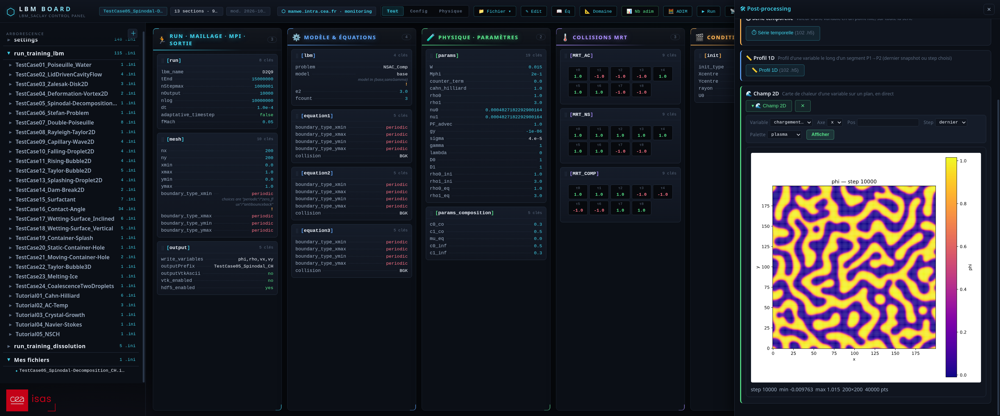

.. _LBM-Board:

LBM Board: Installation & Launch
================================

LBM_Saclay control panel
------------------------

The **LBM Board** is a local web tool (pure Python) to control a full LBM_Saclay workflow in a single page:

- **Pre-processing** — browse and edit the ``.ini`` input files (diff against a reference case, dimensionless numbers, model documentation);
- **Run** — launch a computation on your local CPU, or generate the Slurm submission for the ORCUS GPU partitions;
- **Monitoring** — follow a running computation (log, progress, snapshots);
- **Post-processing** — analyse the ``.h5`` (HDF5) outputs directly in the browser (conservation, time series, 1D profiles, 2D fields).

It binds to ``127.0.0.1`` only: the server is **never exposed** on the network, and by default it **never writes to your disk** (the ``.ini`` export is a browser download; the ■ Stop button of the ▶ Run panel is the
only write action, and it only creates a ``LBMstop`` file in the case directory to stop the solver cleanly, behind a double confirmation).

   Overview of the LBM Board (LBM_Saclay control panel): kanban view of the ``.ini`` input file, computed dimensionless numbers and panels for run, monitoring and post-processing.

1. Prerequisites
----------------

.. admonition:: The board itself: nothing to install
   :class: important

   The board server runs with the **Python standard library only** — it is
   shipped inside the repository (``pre-processing/ini_board/``), there is
   nothing to install to start it.

.. admonition:: Optional — HDF5 post-processing: ``h5py`` + HDF5
   :class: important

   The four **🛠 Post-processing** cards (conservation, time series, 1D
   profile, 2D field) read the ``.h5`` snapshots of your case, so they
   require:

   - HDF5 outputs enabled in your ``.ini`` (``hdf5_enabled = yes`` in the
     section ``[output]``), and
   - the Python library ``h5py`` on the machine where the **board server**
     runs.

   On a laptop or personal desktop (Ubuntu), install once with ``apt``:

      .. code-block:: shell

         $ sudo apt install python3-h5py python3-numpy python3-matplotlib

   ``matplotlib`` is optional: without it the tools still return the CSV
   files (no PNG plots). On the CEA clusters (MANWE, ORCUS) ``h5py`` is
   already available.

   If ``h5py`` is missing, the board still starts normally: the four
   post-processing cards are simply **greyed out** with a warning.

   If ``python3`` does not find ``h5py`` although the ``apt`` packages are
   installed, another Python (virtualenv, conda) shadows the system one:
   check with ``which python3`` and use ``/usr/bin/python3`` instead.

2. Start the board
------------------

.. admonition:: For laptop / desktop
   :class: error

   From the root of your clone, one command:

      .. code-block:: shell

         $ cd LBM_Saclay_Rech-Dev
         $ ./pre-processing/bin/lbm-board.sh

   The page <http://127.0.0.1:8092> opens in your browser.

   Manage the server:

      .. code-block:: shell

         $ ./pre-processing/bin/lbm-board.sh status   # is it running?
         $ ./pre-processing/bin/lbm-board.sh stop     # stop this clone's server

   The script is **idempotent** (one server per clone: re-running it does
   nothing if yours is already active) and **adapts to the machine**
   where it is launched:

      .. table:: Machine, role, port and default bases
      .. table:: Machine, role, port and default bases
         :widths: 20,20,10,50
         :align: center
         :width: 90%

         +-------------+-------------+----------+--------------------------------+
         | **Machine** |  **Role**   | **Port** |       **Default bases**        |
         +=============+=============+==========+================================+
         | local (CPU) |  ``mixte``  |   8092   |           ``/home``            |
         +-------------+-------------+----------+--------------------------------+
         | ``manwe*``  | ``monitor`` |   8093   |   ``/home`` + ``/volatile*``   |
         +-------------+-------------+----------+--------------------------------+
         | ``orcus*``  | ``monitor`` |   9093   | ``/home`` + ``/scratch/catB``  |
         +-------------+-------------+----------+--------------------------------+
         |             |             |          | + ``/tmpformation/LBM_Saclay`` |
         +-------------+-------------+----------+--------------------------------+

   Useful options: ``--role=preproc|monitor|mixte`` (``--role=preproc``
   hides the ▶ Run panel — pure editing), ``--port N`` to force a port.
   If the default port is already taken by **another** instance (another
   student's clone), the script automatically takes the next free port
   and displays it.

3. Access the board from a laptop (SSH tunnel)
----------------------------------------------

.. admonition:: For MANWE / ORCUS (work in SSH)
   :class: important

   The server runs on the cluster, your browser on the laptop, the SSH
   tunnel makes the bridge (the bind is ``127.0.0.1``: the cluster is
   never exposed). Two terminals, the example shows MANWE (for ORCUS use
   port ``9093`` — the script displays the correct tunnel line):

      .. code-block:: shell

         # ── Terminal 1 (work terminal, on the cluster) ─────────────
         $ ssh manwe
         $ cd <your_clone>/LBM_Saclay_Rech-Dev/pre-processing
         $ ./bin/lbm-board.sh                    # server on MANWE (port 8093)

         # ── Terminal 2 (fresh, always from the laptop) ─────────────
         $ ssh -L 8093:127.0.0.1:8093 manwe      # line displayed by the script

   Then open <http://localhost:8093> in your browser. The chip in the top
   left corner (``⬡ manwe… · monitoring``) confirms which machine you are
   on.

   :octicon:`alert-fill;2em;sd-text-info` The ``ssh -L …`` command is
   launched **from the laptop** (the browser's machine), never from the
   cluster. Stop: ``./bin/lbm-board.sh stop`` (terminal 1) + ``Ctrl-C``
   (terminal 2).

4. Point the board to your ``.ini`` files
-----------------------------------------

By default the board loads the case folders of the clone (``settings/``,
``run_training_lbm/``, ``run_training_dissolution/``). To add **your own**
working folders:

1. Edit the file ``pre-processing/ini_board/ini_roots.txt``;
2. Add one line: ``label`` + a tabulation + the path of the folder
   containing your ``.ini`` files (absolute or relative to
   ``pre-processing/ini_board/``);
3. Reload the page (F5) — no need to restart the server.

   .. code-block:: text

      mes_cas                 /home/jdupont/ma_doc/cas_lbm
      serie_magnetohydro      ../../run_training_lbm/serie_magnetohydro

You can also open a single ``.ini`` outside the roots with the **＋**
button of the page (absolute path); it appears under a « Mes fichiers »
root for the current session.

Next page
---------

Editing the ``.ini``, running a computation (local CPU and ORCUS Slurm),
monitoring and HDF5 post-processing are documented in
:bdg-ref-primary-line:`LBM Board: Editing, Run & Post-processing <LBM-Board-Usage>`.

.. sectionauthor:: Alain Cartalade
